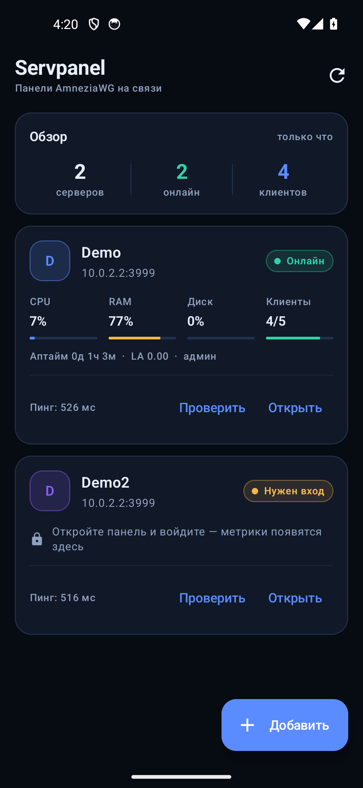
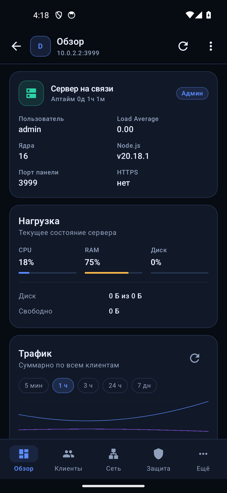
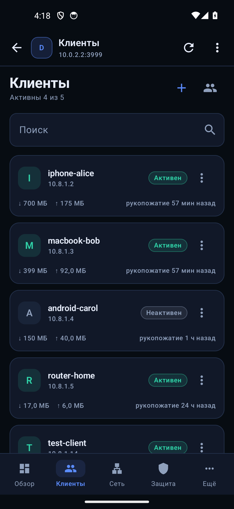
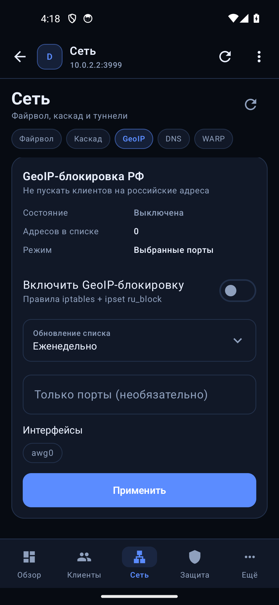
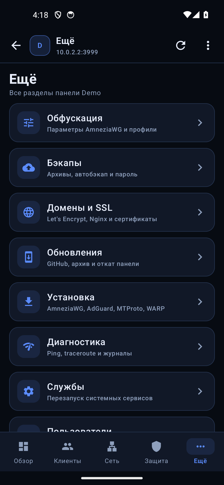

# Servpanel Mobile

Нативное Android-приложение для панели [Servpanel](https://github.com/makar19977v-glitch/servpanel).
Никакого WebView: все разделы панели переписаны на Compose и работают через
REST API, поэтому интерфейс ощущается как приложение, а не как браузер.

<p align="center">
  
  
  
  
  
</p>

## Скачать

[](https://github.com/makar19977v-glitch/servpanel-android/releases/latest)
[](https://github.com/makar19977v-glitch/servpanel-android/releases/latest)
[](https://github.com/makar19977v-glitch/servpanel-android/actions/workflows/android.yml)

- **APK, последняя версия:** [servpanel-mobile.apk](https://github.com/makar19977v-glitch/servpanel-android/releases/latest/download/servpanel-mobile.apk)
- **Все версии и список изменений:** [Releases](https://github.com/makar19977v-glitch/servpanel-android/releases)
- Требуется **Android 8.0** (API 26) или новее.

APK подписан постоянным release-ключом, поэтому обновления ставятся поверх
предыдущей версии — удалять приложение и заново добавлять серверы не нужно.

## Что умеет

**Список серверов (главный экран)**

- Любое количество сохранённых панелей: имя, адрес, цветная метка.
- Живые метрики по каждому серверу: CPU, RAM, диск, загрузка, аптайм,
  клиенты онлайн/всего, задержка ответа.
- Статус: «Онлайн», «Нужен вход», «Не в сети» — с текстом ошибки.
- Автообновление, ручное обновление, обновление одной карточки.
- Добавление, изменение, удаление, проверка подключения при сохранении.
- Отдельные поля «Порт панели», «Порт метрик» и токен metrics-сервера:
  метрики читаются напрямую с порта `PANEL_METRICS_PORT`.

**Рабочее пространство сервера**

Нижние вкладки повторяют структуру панели:

| Вкладка | Что внутри |
| --- | --- |
| **Обзор** | CPU/RAM/диск, аптайм, load average, график трафика за 5 мин / 1 ч / 3 ч / 24 ч / 7 дн |
| **Клиенты** | список с трафиком и хендшейками, создание (в т.ч. пакетное), ключ и QR-код, скачивание `.conf`, переименование, лимит скорости, удаление |
| **Сеть** | UFW (правила и порты), каскад (статус, health-чеки, настройка, обновление, удаление), GeoIP-блокировка РФ, DNS-перехват, Cloudflare WARP |
| **Защита** | 2FA (TOTP + резервные коды), смена пароля, fail2ban, Telegram-уведомления, журнал аудита |
| **Ещё** | Обфускация, Бэкапы, Домены и SSL, Обновления, Установка, Диагностика, Службы, Пользователи, Информация, выход |

- «Обфускация»: оценка параметров AmneziaWG, пресеты, профили, анализ и применение.
- «Бэкапы»: автобэкап, ручной запуск, список архивов, восстановление, пароль архивов.
- «Домены и SSL»: сайты, выпуск и продление Let's Encrypt, установка зависимостей, сертификаты и пути.
- «Обновления»: версия, коммит, отставание от GitHub, обновление через git, по URL и из архива, откат.
- «Установка»: AmneziaWG, AdGuard Home, MTProto, WARP и другие модули.
- «Диагностика»: ping, traceroute, просмотр журналов сервера с копированием.
- «Службы»: статус systemd-сервисов и перезапуск.
- «Пользователи»: создание, роли, смена пароля, удаление.
- «Информация»: IP, домен, страна, сертификат панели и серверный конфиг AmneziaWG.

**Общее**

- Параллельная работа с несколькими серверами: у каждого свой клиент и своя сессия.
- Тёмная палитра в стиле панели (`#070B12`, `#5B8CFF`, `#8B5CF6`, `#2DD4A7`).
- QR-коды клиентов и 2FA рендерятся локально из data URL.
- Конфиги и архивы отдаются через системное «Поделиться» (FileProvider).
- Русский интерфейс.

## Как это работает

```
┌─────────────────────────────── Android ───────────────────────────────┐
│  AppViewModel                                                          │
│    ├── список серверов (SharedPreferences + JSON)                      │
│    ├── опрос метрик: OkHttp → /api/sysinfo, /api/clients,              │
│    │                  /api/security/status                             │
│    └── PanelClient на каждый сервер                                    │
│            ├── OkHttp + PersistentCookieJar (panel.sid)                │
│            └── REST API панели → модели → Compose-экраны               │
└────────────────────────────────────────────────────────────────────────┘
```

- Пароли приложение **не хранит**. Вход выполняется через `POST /api/login`
  (логин, пароль, при необходимости код 2FA), сессия `panel.sid` живёт
  в cookie-хранилище OkHttp, отдельном для каждого сервера.
- Все запросы идут в фоне (`Dispatchers.IO`), поэтому интерфейс не блокируется.
- Сервер не нужно обновлять или патчить: приложение работает с публичным
  API панели версии 2.x.
- Если сессия истекла, экран входа откроется автоматически; выход завершает
  сессию и на сервере (`POST /api/logout`).

### Панель без веб-интерфейса

Приложению нужен только REST API, поэтому HTML-интерфейс панели можно
выключить. В `server.js` панели есть два режима (переменные окружения):

```bash
# веб выключен, API остаётся на основном порту
PANEL_WEB=0 PANEL_HOST=127.0.0.1 PANEL_PORT=3000 node server.js

# плюс отдельный порт только для /api/*
PANEL_WEB=0 PANEL_API_PORT=3443 PANEL_API_HOST=0.0.0.0 node server.js
```

В приложении укажите адрес API-порта (`https://panel.example.com:3443` или
`http://10.8.0.1:3443`). Проверка подключения обращается к
`/api/security/status`, поэтому такой порт определяется как обычная панель.

### HTTPS без Nginx

Прокси перед панелью не обязателен: `server.js` умеет сам слушать HTTPS.
Обратный прокси не нужен ни приложению, ни серверу.

```bash
PANEL_WEB=0 PANEL_HTTP=0 \
PANEL_TLS_PORT=3443 \
PANEL_TLS_CERT=/etc/ssl/servpanel/fullchain.pem \
PANEL_TLS_KEY=/etc/ssl/servpanel/privkey.pem \
node server.js
```

В приложении адрес будет `https://panel.example.com:3443`. Для
самоподписанного сертификата включите в настройках сервера переключатель
«Самоподписанный сертификат» — иначе OkHttp отклонит соединение
(`SSLHandshakeException`).

Сертификат Let's Encrypt продлевается без перезапуска: `certbot` вызывает
`--deploy-hook "kill -HUP <pid>"`, и панель перечитывает файлы на лету.

Сам по себе скрытый веб не защищает API: права те же. Держите порт за HTTPS
или внутри VPN, ограничьте его в UFW и включите 2FA. Самый устойчивый к
блокировкам вариант — вообще не открывать панель в интернет:

```bash
PANEL_TLS_HOST=10.8.0.1 PANEL_TLS_PORT=3443 ...
ufw deny 3443/tcp
```

Тогда приложение подключается к `https://10.8.0.1:3443` только при поднятом
WireGuard-туннеле.

### Порты панели и метрик

В настройках сервера адрес и порты задаются отдельно:

| Поле | Что означает | Когда заполнять |
| --- | --- | --- |
| **Адрес панели** | схема + хост (например, `https://panel.example.com`) | всегда |
| **Порт панели** | порт API/HTTPS панели (`PANEL_TLS_PORT` или `PANEL_API_PORT`) | если он не входит в адрес |
| **Порт метрик** | порт отдельного metrics-сервера панели (`PANEL_METRICS_PORT`) | если на панели включены метрики |
| **Токен метрик** | `PANEL_METRICS_TOKEN` | если metrics-сервер требует токен |

Порт панели можно как писать прямо в адресе (`https://host:3443`), так и
вынести в поле — приложение не хранит его дважды. Если поле пустое,
используется порт из адреса (443 для HTTPS, 80 для HTTP).

Metrics-сервер включается на стороне панели:

```bash
PANEL_METRICS_PORT=9101 \
PANEL_METRICS_HOST=0.0.0.0 \
PANEL_METRICS_TOKEN='длинный-случайный-токен' \
node server.js
```

Приложение обращается к `https://host:9101/metrics` с заголовком
`Authorization: Bearer <токен>` и берёт оттуда CPU, RAM, диск, аптайм и
количество клиентов. Токен хранится только на устройстве. Если порт метрик
не задан, цифры читаются из `/api/sysinfo` панели (медленнее и требует входа).

Метрики используют тот же TLS-сертификат, что и панель, поэтому для
самоподписанного сертификата включите соответствующую опцию в настройках
сервера.

## Сборка

Нужны **JDK 17** и **Android SDK 35** (Android Studio поставит их сам).

### Вариант 1. Android Studio

1. `File → Open` → выберите папку `servpanel-android`.
2. Дождитесь Gradle Sync (студия сама создаст `local.properties`).
3. `Run ▶` на устройстве или эмуляторе.

### Вариант 2. Командная строка

```bash
# Linux / macOS
export ANDROID_HOME=$HOME/Android/Sdk
./gradlew assembleDebug

# Windows (PowerShell)
$env:ANDROID_HOME="$env:LOCALAPPDATA\Android\Sdk"
.\gradlew.bat assembleDebug
```

Готовый APK: `app/build/outputs/apk/debug/app-debug.apk`.

Установка на телефон:

```bash
adb install -r app/build/outputs/apk/debug/app-debug.apk
```

или просто скопируйте APK на устройство и откройте (разрешите установку
из неизвестных источников).

### Сборка в GitHub Actions

В проекте есть workflow `.github/workflows/android.yml`: при каждом push
в `main` он собирает debug-APK и выкладывает его в артефакты сборки.
Скачать: вкладка **Actions → Build APK → последний запуск → Artifacts**.

## Первый запуск

1. Нажмите **«Добавить»**.
2. Введите адрес панели так, как открываете её в браузере:
   `panel.example.com`, `1.2.3.4:3000` или полный `https://panel.example.com`.
   Схему можно не указывать — приложение само попробует `https`, затем `http`.
3. Нажмите **«Проверить подключение»** — появится задержка и информация,
   потребуется ли вход.
4. Сохраните и откройте сервер: появится экран входа панели.
5. Введите логин, пароль и код 2FA (если включён). Откроется «Обзор».

Дальше добавьте остальные серверы — они появятся в списке, а переключение
между ними выполняется одним нажатием.

## Самоподписанный сертификат

Если панель использует самоподписанный TLS-сертификат, включите
**«Самоподписанный сертификат»** в настройках сервера. Приложение будет
доверять только этому серверу, остальные проверяются как обычно.

Для боевых серверов лучше выпустить обычный сертификат Let's Encrypt
(вкладка «Домены и SSL»).

## Ограничения

- **Нет push-уведомлений.** Опрос идёт, пока приложение открыто.
  Фоновый мониторинг можно добавить отдельным модулем WorkManager.
- **Android 8.0+** (minSdk 26).
- **API панели 2.x.** Если в новой версии Servpanel поменяются эндпоинты,
  соответствующие экраны потребуют обновления приложения.
- Операции, требующие root/systemd (удаление клиента, UFW, обновления),
  работают только на реальном Linux-сервере — в демо-режиме панель может
  отвечать ошибкой.

## Структура проекта

```
app/src/main/java/ru/servpanel/mobile/
├── MainActivity.kt             точка входа
├── AppRoot.kt                  навигация: серверы → рабочее пространство → редактор
├── AppViewModel.kt             состояние, авторизация, клиенты по серверам
├── data/
│   ├── ServerProfile.kt        модель сервера, палитра, разбор адреса
│   ├── ServersStore.kt         хранение списка (SharedPreferences + JSON)
│   └── PanelModels.kt          модели и парсеры ответов API
├── net/
│   ├── PanelClient.kt          REST-клиент всех разделов панели
│   ├── PanelApi.kt             проверка подключения и сводка состояния
│   ├── PersistentCookieJar.kt  cookie-сессия panel.sid на каждый сервер
│   ├── HttpClients.kt          OkHttp, самоподписанные сертификаты
│   └── ServerHealth.kt         модель сводки
└── ui/
    ├── ServersScreen.kt        главный экран со всеми серверами
    ├── WorkspaceScreen.kt      каркас сервера и нижние вкладки
    ├── LoginScreen.kt          вход в панель (логин, пароль, 2FA)
    ├── OverviewScreen.kt       обзор и график трафика
    ├── ClientsScreen.kt        клиенты, ключи, QR, лимиты
    ├── NetworkScreen.kt        UFW, каскад, GeoIP, DNS, WARP
    ├── SecurityScreen.kt       2FA, пароль, fail2ban, уведомления, аудит
    ├── MoreScreen.kt           список остальных разделов
    ├── ObfuscationScreen.kt    обфускация AmneziaWG
    ├── BackupsScreen.kt        бэкапы и восстановление
    ├── SslScreen.kt            домены и сертификаты
    ├── UpdatesScreen.kt        обновления панели
    ├── InstallScreen.kt        установка модулей
    ├── DiagnosticsScreen.kt    ping, traceroute, журналы
    ├── ServicesScreen.kt       systemd-сервисы
    ├── UsersScreen.kt          пользователи панели
    ├── ServerInfoScreen.kt     IP, домен, сертификат, конфиг
    ├── EditorScreen.kt         добавление и настройка сервера
    ├── Components.kt           карточки, кнопки, поля, чипы
    ├── Share.kt                буфер обмена и «Поделиться»
    └── theme/Theme.kt          палитра в стиле Servpanel
```

## Приватность

Приложение не отправляет данные никуда, кроме указанных вами серверов.
Список серверов хранится локально, пароли не сохраняются, аналитики нет.

## Лицензия

MIT — как и у самой панели Servpanel.
